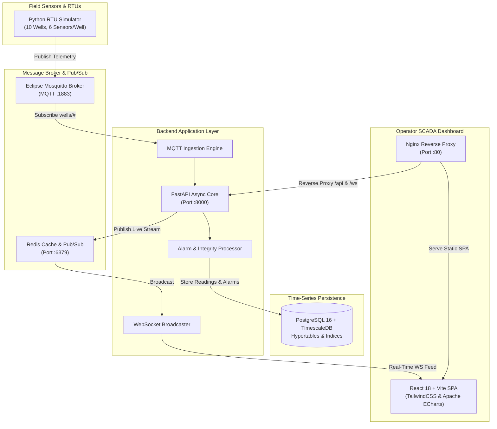

# 🛢️ Wellhead Pressure & Integrity Monitoring System (SCADA / IIoT)

[](https://fastapi.tiangolo.com)
[](https://react.dev/)
[](https://www.timescale.com/)
[](https://mosquitto.org/)
[](https://redis.io/)
[](https://www.docker.com/)
[](https://tailwindcss.com/)

An enterprise-grade, real-time **SCADA & Industrial IoT (IIoT) Wellhead Pressure & Integrity Monitoring Platform** developed for upstream oil and gas operations.

This system provides continuous surveillance of wellhead barriers, surface pressures (Tubing, Flowline, Choke, Annuli A/B/C), dynamic threshold alarms, well integrity watchlist risk scoring, and production telemetry tracking with sub-second WebSocket updates.

---

## 📌 Table of Contents

- [Overview](#-overview)
- [System Architecture](#-system-architecture)
- [Key Features](#-key-features)
- [Telemetry & Sensor Metrics](#-telemetry--sensor-metrics)
- [Technology Stack](#-technology-stack)
- [Project Directory Structure](#-project-directory-structure)
- [Quick Start Guide](#-quick-start-guide)
  - [Option A: Unified Docker Deployment (Recommended)](#option-a-unified-docker-deployment-recommended)
  - [Option B: Local Development Setup](#option-b-local-development-setup)
- [Default Credentials & Access Points](#-default-credentials--access-points)
- [API Reference](#-api-reference)
- [Project Artifacts & Reports](#-project-artifacts--reports)
- [Author & License](#-author--license)

---

## 📖 Overview

In offshore and onshore oil & gas facilities, maintaining wellhead barrier integrity is vital to prevent blowouts, casing damage, and environmental catastrophes. 

This platform acts as a digital SCADA operator interface that:
1. Ingests high-frequency sensor readings from field RTUs (Remote Terminal Units) via **MQTT**.
2. Stores high-resolution time-series data using **PostgreSQL + TimescaleDB** hypertables.
3. Broadcasts instant pressure updates to operators via **Redis Pub/Sub** and **WebSockets** (< 100ms latency).
4. Evaluates real-time values against **MAOP** (Maximum Allowable Operating Pressure) and **MAASP** (Maximum Allowable Annular Surface Pressure) safety envelopes.
5. Manages the lifecycle of critical alerts (HI, HI-HI, LO, LO-LO) with acknowledgeable operator workflows.

---

## 🏗️ System Architecture



---

## ⚡ Key Features

- **Real-Time Telemetry Dashboard**: Live monitoring cards for all active platform wells with color-coded status badges (`NORMAL`, `WARNING`, `CRITICAL`, `SHUT-IN`).
- **Detailed Well Telemetry Drill-Down**: In-depth telemetry per well showing:
  - Tubing Head Pressure (**THP**)
  - Flowline Pressure
  - Choke Downstream Pressure
  - Annulus A, Annulus B, and Annulus C Pressures
- **Live Interactive Trends**: High-frequency chart rendering powered by **Apache ECharts** with historical zoom, pan, and real-time append.
- **Alarm Management System**:
  - Multi-tier severity levels: `CRITICAL`, `WARNING`, `INFO`.
  - Configurable setpoints: **HI**, **HI-HI**, **LO**, **LO-LO**.
  - Operator workflow: Timestamp tracking, active state, and one-click **Acknowledgment** with audit trail.
- **Wellhead Integrity Watchlist**:
  - Surveillance of annular pressure buildup (Sustained Casing Pressure - SCP).
  - Continuous validation against **MAASP** limits to safeguard against casing burst or collapse.
- **Production Analytics**: Correlates wellhead pressure curves with flow rates (BPD) and choke opening percentages.
- **Role-Based Access Control (RBAC)**: Secure JWT authentication separating `ADMIN`, `OPERATOR`, `ENGINEER`, and `VIEWER` permissions.
- **All-in-One Unified Docker Container**: Fully self-contained container bundle orchestrating TimescaleDB, Redis, Mosquitto, FastAPI, React, and Supervisord in a single deployable image.

---

## 📡 Telemetry & Sensor Metrics

| Sensor Name | Parameter Description | Typical Range | Safety Limits |
| :--- | :--- | :--- | :--- |
| **Tubing Head Pressure (THP)** | Pressure inside production tubing string | 1,000 - 4,000 PSI | MAOP: 5,000 PSI |
| **Flowline Pressure** | Surface line carrying hydrocarbons to manifold | 500 - 2,000 PSI | Operating Max: 2,000 PSI |
| **Choke Downstream** | Pressure drop across wellhead control choke | 300 - 1,500 PSI | Operating Max: 1,500 PSI |
| **Annulus A Pressure** | Space between tubing string and production casing | 0 - 2,500 PSI | MAASP: 2,500 PSI |
| **Annulus B Pressure** | Intermediate casing-to-surface casing annular space | 0 - 3,000 PSI | MAASP: 3,000 PSI |
| **Annulus C Pressure** | Surface casing-to-conductor annular space | 0 - 1,000 PSI | MAASP: 1,000 PSI |

---

## 💻 Technology Stack

### Frontend
- **Framework**: React 18 (Vite build system)
- **Styling**: Tailwind CSS, PostCSS
- **Visualizations**: Apache ECharts (`echarts-for-react`)
- **Icons**: Lucide React
- **HTTP & Sockets**: Axios, Native WebSockets

### Backend
- **Framework**: FastAPI (Python 3.12, ASGI)
- **Database ORM**: SQLAlchemy 2.0 (Asyncio) + Asyncpg / Psycopg2
- **Data Validation**: Pydantic v2
- **Auth**: Passlib (Bcrypt), PyJWT (HS256)
- **Messaging Client**: Paho-MQTT v2, Redis-py
- **Server**: Uvicorn (ASGI web server)

### Storage & Infrastructure
- **Database**: PostgreSQL 16 with **TimescaleDB** extension for high-performance time-series hypertables
- **MQTT Broker**: Eclipse Mosquitto
- **In-Memory Cache & Pub/Sub**: Redis 7
- **Reverse Proxy**: Nginx
- **Process Supervisor**: Supervisord
- **Containerization**: Docker (Multi-stage build)

---

## 📂 Project Directory Structure

```text
├── 35_SELVAMANI_M/                      # Project Reports & Presentation
│   ├── Selvamani_M Ecrio Report.pdf     # Detailed Project Documentation Report
│   └── Wellhead_Pressure_Monitoring_Dashboard_PPT.pptx # Project Slide Deck
│
├── wellhead-pressure-monitoring/
│   ├── backend/                         # FastAPI Application Core
│   │   ├── app/
│   │   │   ├── api/                     # REST & WebSocket endpoints
│   │   │   │   ├── alarms.py            # Alarm query and acknowledgment
│   │   │   │   ├── auth.py              # User authentication & token issue
│   │   │   │   ├── integrity.py         # Well integrity risk analytics
│   │   │   │   ├── production.py        # Production rates & telemetry
│   │   │   │   ├── users.py             # User administration
│   │   │   │   ├── wells.py             # Well metadata & sensor history
│   │   │   │   └── ws.py                # Real-time WebSocket handlers
│   │   │   ├── auth/                    # Security, hashing & JWT handling
│   │   │   ├── config/                  # App configuration & settings
│   │   │   ├── database/                # Database connection & async engine
│   │   │   ├── models/                  # SQLAlchemy ORM domain entities
│   │   │   ├── mqtt/                    # MQTT subscription & processing
│   │   │   └── schemas/                 # Pydantic request/response schemas
│   │   ├── Dockerfile                   # Standalone Backend Dockerfile
│   │   ├── requirements.txt             # Python backend dependencies
│   │   └── main.py                      # Application bootstrap & seed routine
│   │
│   ├── frontend/                        # React + Vite Application
│   │   ├── src/
│   │   │   ├── components/              # Layout, WellTile, TrendChart components
│   │   │   ├── context/                 # AuthContext & WebSocketContext
│   │   │   ├── pages/                   # Dashboard, Wells, Alarms, Integrity, etc.
│   │   │   ├── services/                # Axios API service definitions
│   │   │   ├── App.jsx                  # Application routing & layout tree
│   │   │   ├── main.jsx                 # Vite root entrypoint
│   │   │   └── index.css                # Tailwind CSS stylesheets
│   │   ├── package.json                 # Node.js dependencies
│   │   └── vite.config.js               # Vite bundler configuration
│   │
│   ├── simulator/                       # RTU Telemetry Field Simulator
│   │   ├── simulator.py                 # Multi-well pressure data generator
│   │   ├── requirements.txt             # Simulator dependencies (paho-mqtt)
│   │   └── Dockerfile                   # Standalone simulator container
│   │
│   ├── config/                          # YAML well configuration templates
│   │   └── wells/WELL-001.yaml          # Setpoint definitions (MAOP, MAASP, thresholds)
│   │
│   ├── database/
│   │   └── init.sql                     # Postgres + TimescaleDB schema initialization
│   │
│   ├── docker/                          # Container orchestration utilities
│   │   ├── entrypoint.sh                # Container startup & service orchestration
│   │   ├── nginx.conf                   # Nginx reverse proxy routing
│   │   └── supervisord.conf             # Multi-process supervisor configuration
│   │
│   ├── Dockerfile                       # Multi-stage All-in-One container image
│   └── README.md                        # Subfolder quick reference
│
├── .gitignore                           # Git ignore rules for node_modules, venvs, and logs
└── README.md                            # Main project documentation (this file)
```

---

## 🚀 Quick Start Guide

### Option A: Unified Docker Deployment (Recommended)

The easiest way to run the entire stack (PostgreSQL + TimescaleDB, Redis, Mosquitto, FastAPI, React Frontend, and RTU Simulator) is using the unified Docker image:

1. **Clone the repository**:
   ```bash
   git clone https://github.com/Selva02092005/Wellhead-Pressure-Monitoring.git
   cd Wellhead-Pressure-Monitoring/wellhead-pressure-monitoring
   ```

2. **Build the container image**:
   ```bash
   docker build -t wellhead-monitoring:latest .
   ```

3. **Run the container**:
   ```bash
   docker run -d --name wellhead_system \
     -p 80:80 \
     -p 8000:8000 \
     -p 1883:1883 \
     wellhead-monitoring:latest
   ```

4. **Access the application**:
   - Open your web browser at **`http://localhost`**
   - Direct FastAPI API Documentation: **`http://localhost:8000/docs`**

---

### Option B: Local Development Setup

If you prefer running services individually for local development:

#### Prerequisites
- **Node.js** (v18+) & **npm**
- **Python** (v3.12+)
- **PostgreSQL 16** (with TimescaleDB extension enabled)
- **Redis Server** running locally (`127.0.0.1:6379`)
- **Mosquitto MQTT Broker** running locally (`127.0.0.1:1883`)

#### 1. Database Setup
```bash
# Connect to your local PostgreSQL instance and execute the schema initialization
psql -U postgres -d wellhead -f wellhead-pressure-monitoring/database/init.sql
```

#### 2. Backend Setup
```bash
cd wellhead-pressure-monitoring/backend

# Create and activate a virtual environment
python -m venv .venv
# On Windows:
.venv\Scripts\activate
# On Linux/macOS:
source .venv/bin/activate

# Install dependencies
pip install -r requirements.txt

# Start FastAPI development server
uvicorn app.main:app --host 0.0.0.0 --port 8000 --reload
```

#### 3. RTU Data Simulator
```bash
cd wellhead-pressure-monitoring/simulator

# Run the simulation engine to generate MQTT telemetry
python simulator.py
```

#### 4. Frontend Setup
```bash
cd wellhead-pressure-monitoring/frontend

# Install dependencies
npm install

# Start Vite development server
npm run dev
```
Open **`http://localhost:5173`** to access the dashboard in development mode.

---

## 🔑 Default Credentials & Access Points

| Service / Interface | URL / Host | Default Credentials / Note |
| :--- | :--- | :--- |
| **Web SCADA Dashboard** | `http://localhost:80` (or `:5173` in dev) | `admin` / `admin123` |
| **API Swagger UI** | `http://localhost:8000/docs` | Interactive OpenAPI documentation |
| **API ReDoc** | `http://localhost:8000/redoc` | Alternative API reference |
| **WebSocket Stream** | `ws://localhost:8000/api/ws/telemetry` | Real-time telemetry feed |
| **MQTT Broker** | `localhost:1883` | Default topic: `wells/{well_id}/{sensor}` |

---

## 🔌 API Reference

### Authentication (`/api/auth`)
- `POST /api/auth/login` - Authenticate user credentials and return JWT bearer token.
- `GET /api/auth/me` - Retrieve current authenticated user profile and assigned role.

### Wells Management (`/api/wells`)
- `GET /api/wells` - List all registered wellheads with latest sensor summaries and status.
- `GET /api/wells/{well_id}` - Retrieve metadata, configuration setpoints, and sensor layout.
- `GET /api/wells/{well_id}/readings` - Fetch historical time-series readings with optional time window filtering.

### Alarms & Alerts (`/api/alarms`)
- `GET /api/alarms` - Query alarm events by status (`ACTIVE`, `ACKNOWLEDGED`) and severity (`CRITICAL`, `WARNING`).
- `POST /api/alarms/{alarm_id}/acknowledge` - Acknowledge an active alarm with operator identity.

### Well Integrity (`/api/integrity`)
- `GET /api/integrity/watchlist` - Retrieve wells exceeding or approaching MAASP/MAOP envelopes.

### Production Telemetry (`/api/production`)
- `GET /api/production/overview` - Aggregated platform production rates (BPD) and choke data.

---

## 📑 Project Artifacts & Reports

The project repository includes comprehensive documentation and presentations located in the `35_SELVAMANI_M/` folder:
- **`Selvamani_M Ecrio Report.pdf`**: Complete technical and architectural report detailing design choices, telemetry calculation logic, and SCADA monitoring compliance.
- **`Wellhead_Pressure_Monitoring_Dashboard_PPT.pptx`**: Executive presentation slide deck presenting platform features, architecture, and deployment strategy.

---

## 👨‍💻 Author & License

- **Developer**: Selvamani M
- **Project**: Ecrio Wellhead Pressure Monitoring System
- **Repository**: [https://github.com/Selva02092005/Wellhead-Pressure-Monitoring](https://github.com/Selva02092005/Wellhead-Pressure-Monitoring)
- **License**: MIT License
